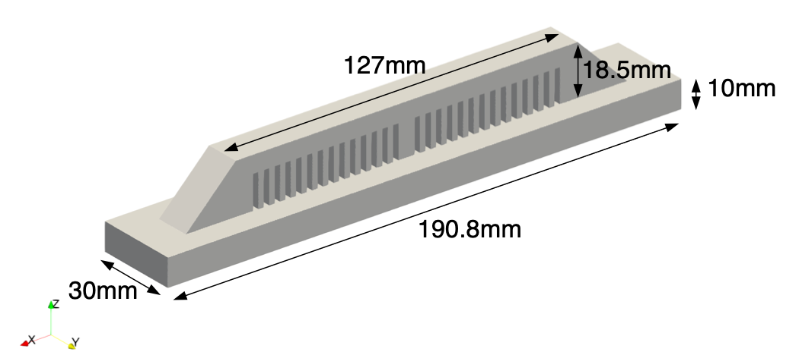
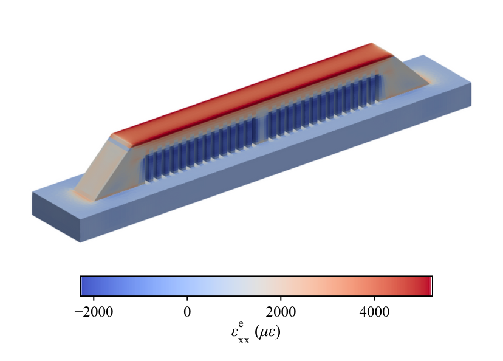
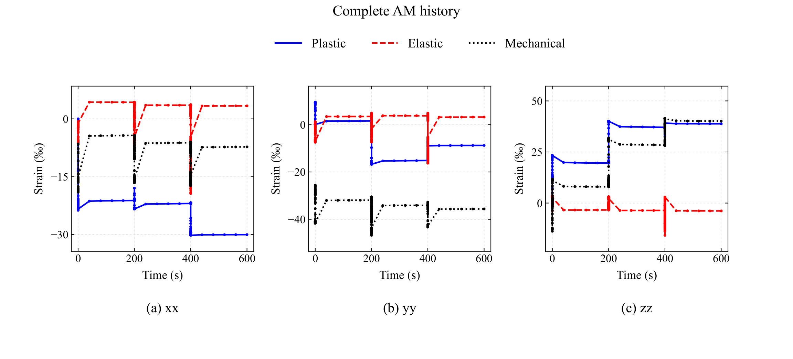
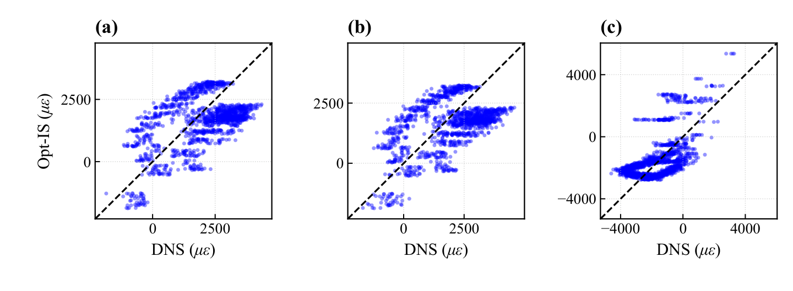
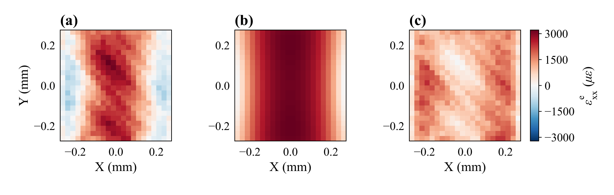
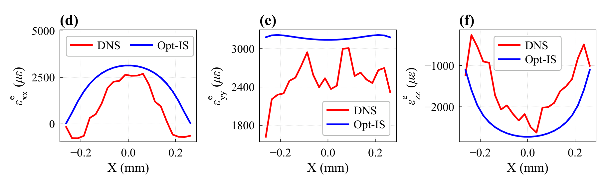
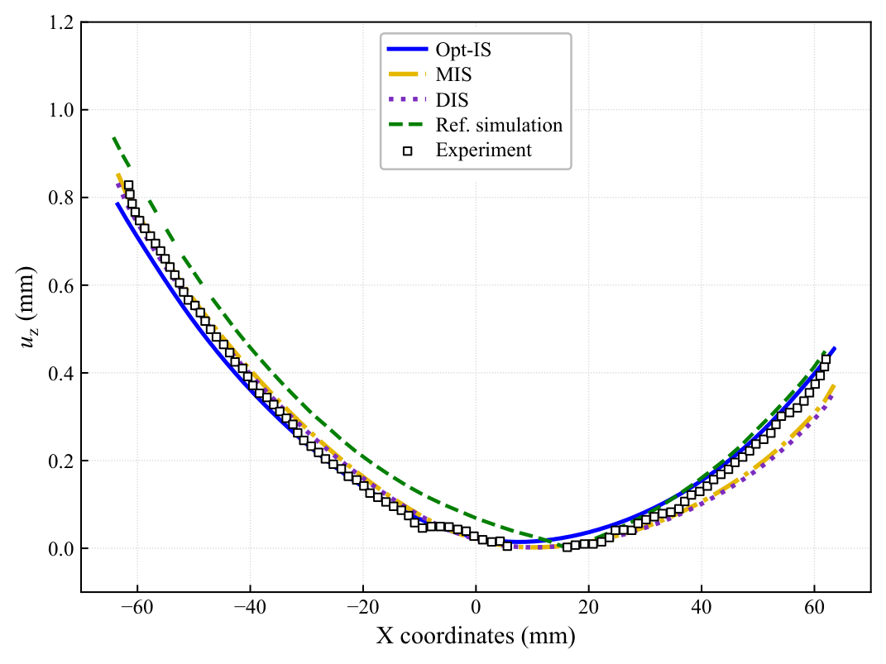



<link rel="stylesheet" href="{{ '/assets/css/residual-stress-hub.css' | relative_url | bust_file_cache }}">

<section class="rsh-hero rsh-hero-with-background" aria-label="Residual Stress Hub">

<a class="rsh-hero-brand rsh-site-title" href="{{ '/' | relative_url }}" aria-label="Residual Stress Hub home">

Residual Stress Hub
</a>
</section>

[← All benchmarks](/benchmarks/)

## Overview

This is the IN718 double-cantilever model. A local thermal–mechanical simulation is used to identify inherent strain, and the model calculates residual stress and warpage after releasing the left and right interfaces. <a href="#reference-1">[1]</a>

<figure class="rsh-case-figure" markdown="1">

_Figure 1. Geometry and dimensions._

[Download the original geometry PDF](/assets/pdf/cases/double_cantilever/geometry-overview.pdf)

</figure>

## Problem set

### Printing parameters

| Parameter                                                         | Value              | Unit |
| ----------------------------------------------------------------- | ------------------ | ---- |
| Manufacturing process                                             | LPBF               | —    |
| Material                                                          | IN718              | —    |
| Heat-source power, $P$                                            | 285                | W    |
| Scan speed, $V$                                                   | 960                | mm/s |
| Physical deposition layer thickness                               | 40                 | µm   |
| Hatch spacing                                                     | 110                | µm   |
| Absorption efficiency                                             | 0.4                | —    |
| Goldak heat-source dimensions (front / rear / transverse / depth) | 50 / 50 / 50 / 125 | µm   |
| Cooling interval (after each deposited layer)                     | 200                | s    |

### Temperature-dependent material parameters

The temperature-dependent thermal and mechanical parameters used in the local scan model for inherent-strain identification are taken from Dunbar et al., Tables 4–6 <a href="#reference-2">[2]</a>.

**IN718 — upper region and lower region.** Density, $\rho$ = 8146 kg/m³. Latent heat, $L$ = 286000 J/kg. Solidus temperature, $T_{\mathrm{s}}$ = 1533 K. Liquidus temperature, $T_{\mathrm{l}}$ = 1609 K. Maximum yield factor = 1.

Symbols: $C_{\mathrm{p}}$, specific heat capacity; $k$, thermal conductivity; $E$, Young’s modulus; $\sigma_{\mathrm{y}}$, initial yield stress; $\alpha$, thermal expansion coefficient; $\nu$, Poisson ratio; $H$, hardening modulus; $\sigma_{\mathrm{max}}$, maximum yield stress.

#### Thermal properties

| $T$ (°C) | $C_{\mathrm{p}}$ (J/(kg·K)) | $k$ (W/(m·K)) |
| -------- | --------------------------- | ------------- |
| 20       | 427                         | 11.4          |
| 100      | 441                         | 12.5          |
| 300      | 481                         | 14            |
| 500      | 521                         | 15.5          |
| 700      | 601                         | 21.5          |
| 1350     | 691                         | 31.3          |

#### Mechanical properties

| $T$ (°C) | $E$ (GPa) | $\sigma_{\mathrm{y}}$ (MPa) | $\alpha$ (µm/(m·K)) | $\nu$ (—) | $H$ (GPa) |
| -------- | --------- | --------------------------- | ------------------- | --------- | --------- |
| 21       | 208       | 1172                        | 12.8                | 0.3       | 0         |
| 93       | 205       | 1172                        | 12.8                | —         | 0         |
| 204      | 202       | —                           | 13.5                | —         | —         |
| 316      | 194       | —                           | 13.9                | —         | —         |
| 427      | 186       | 1089                        | 14.2                | —         | 0         |
| 538      | 179       | 1068                        | 14.4                | —         | 0         |
| 649      | 172       | 1034                        | 15.1                | —         | 0         |
| 760      | 162       | 827                         | 16.1                | —         | 0         |
| 871      | 127       | 286                         | —                   | —         | 0         |
| 954      | 17.8      | 138                         | 16.2                | —         | 0         |
| 1350     | —         | —                           | —                   | 0.3       | —         |

A dash denotes no independent tabulated value at that temperature, not zero. Each property is linearly interpolated on its own temperature grid, with the nearest endpoint held outside that range.

Maximum yield stress, $\sigma_{\mathrm{max}}$, is $1\,\sigma_{\mathrm{y}}$ at each interpolated temperature.

[Download full parameter JSON](/assets/data/cases/double_cantilever/thermal-parameters.json) · [Download temperature-dependent CSV](/assets/data/cases/double_cantilever/temperature-dependent-properties.csv) · [Download simulation YAML](/assets/data/cases/double_cantilever/simulation-parameters.yaml)

### Inherent strain solution parameters

| Parameter                                                                                         | Value / setting                                                             | Unit              |
| ------------------------------------------------------------------------------------------------- | --------------------------------------------------------------------------- | ----------------- |
| Ambient temperature                                                                               | 25                                                                          | °C                |
| High-temperature material model                                                                   | See tables above                                                            | —                 |
| Elastic parameters (room temperature, constant)                                                   | $E$ = 208 $\nu$ = 0.3                                                    | GPa —          |
| Plastic parameters (room temperature, constant)                                                   | $\sigma_{\mathrm{y}}$ = 1172 $H$ = 0 $\sigma_{\mathrm{max}}$ = 1172   | MPa GPa MPa |
| Identified inherent strain, $\varepsilon_{\mathrm{xx}}^{\ast} = \varepsilon_{\mathrm{yy}}^{\ast}$ | -4.339                                                                      | ‰                 |
| Identified inherent strain, $\varepsilon_{\mathrm{zz}}^{\ast}$                                    | 19.647                                                                      | ‰                 |
| Layer activation                                                                                  | 36 × 0.515                                                                  | Layers × mm       |
| Constraints and release                                                                           | fixed plane $Z$ = 10 mm; release left and right interfaces at $Z$ = 32.2 mm | —                 |
| Thermal strain reference temperature                                                              | 25                                                                          | °C                |
| Thermal strain cutoff                                                                             | solidus                                                                     | —                 |

[Download simulation configuration](/assets/data/cases/double_cantilever/macro-parameters.yaml) · [Download identification results](/assets/data/cases/double_cantilever/identification-results.json)

## Results

<figure class="rsh-case-figure" markdown="1">

### Axial elastic-strain field

<em>Figure 2. Double-cantilever axial elastic strain $\varepsilon^{\mathrm{e}}_{\mathrm{xx}}$ (µε).</em>

The contour shows the axial elastic-strain component in the IN718 double-cantilever model. Positive and negative values denote extension and contraction. Release displacement is a different quantity and is shown in millimeters below.

[Download the figure PDF](/assets/pdf/cases/double_cantilever/results-cover.pdf)

</figure>

<figure class="rsh-case-figure" markdown="1">

### Local strain histories

<em>Figure 3. Saved Double-cantilever local $xx$, $yy$ and $zz$ strain histories (‰).</em>

The three panels show the saved plastic, elastic, and mechanical normal-strain components over the local scanning and cooling calculation. One per mille equals 0.001 strain. This figure contains strain histories only. The downloadable PDF also includes three scan-window detail pages.

[Download all local strain-history pages](/assets/pdf/cases/double_cantilever/thermal-history.pdf)

</figure>

<figure class="rsh-case-figure" markdown="1">

### Local elastic-strain agreement

<em>Figure 4. Double-cantilever local calibration: $xx$, $yy$ and $zz$ elastic-strain parity (µε).</em>

The panels compare Opt-IS with DNS on 1452 paired active native cells. The dashed diagonal denotes exact agreement. Departures from the diagonal show the remaining mismatch rather than part-scale experimental uncertainty.

[Download the figure PDF](/assets/pdf/cases/double_cantilever/strain-parity.pdf) · [Download archived error metrics](/assets/data/cases/double_cantilever/optimization-metrics.csv)

</figure>

<figure class="rsh-case-figure" markdown="1">

### Local elastic-strain maps

<em>Figure 5. Double-cantilever local $\varepsilon^{\mathrm{e}}_{\mathrm{xx}}$ maps (µε).</em>

The three panels show DNS, Opt-IS, and the signed difference Opt-IS minus DNS on the local top layer. The color scale measures elastic strain.

[Download the figure PDF](/assets/pdf/cases/double_cantilever/strain-spatial.pdf)

</figure>

<figure class="rsh-case-figure" markdown="1">

### Local elastic-strain profiles

<em>Figure 6. Double-cantilever local $xx$, $yy$ and $zz$ elastic-strain profiles (µε).</em>

The three normal elastic-strain components are sampled along the native top-plane row and compared between DNS and Opt-IS. These curves describe the local calibration model.

[Download the figure PDF](/assets/pdf/cases/double_cantilever/strain-spatial.pdf)

</figure>

<figure class="rsh-case-figure" markdown="1">

### Vertical displacement after cutting

<em>Figure 7. Double-cantilever post-cut vertical displacement $u_z$ for the 127 mm specimen (mm).</em>

Opt-IS, MIS, DIS, the supplied reference simulation, and experiment are compared along the specimen. Both ends lift after cutting, with greater uplift on the left and a low-displacement central region.

[Download the figure PDF](/assets/pdf/cases/double_cantilever/warpage.pdf) · [Download displacement samples](/assets/data/cases/double_cantilever/warpage.csv)

</figure>

---

**Reference:**

[1] Chen, Q., Liang, X., Hayduke, D., Liu, J., Cheng, L., Oskin, J., Whitmore, R., To, A.C. (2019). An inherent strain based multiscale modeling framework for simulating part-scale residual deformation for direct metal laser sintering. _Additive Manufacturing_, **28**, 406–418. [https://doi.org/10.1016/j.addma.2019.05.021](https://doi.org/10.1016/j.addma.2019.05.021).

[2] Dunbar, A.J., Denlinger, E.R., Gouge, M.F., Michaleris, P. (2016). Experimental validation of finite element modeling for laser powder bed fusion deformation. _Additive Manufacturing_, **12**, 108–120. [https://doi.org/10.1016/j.addma.2016.08.003](https://doi.org/10.1016/j.addma.2016.08.003).
